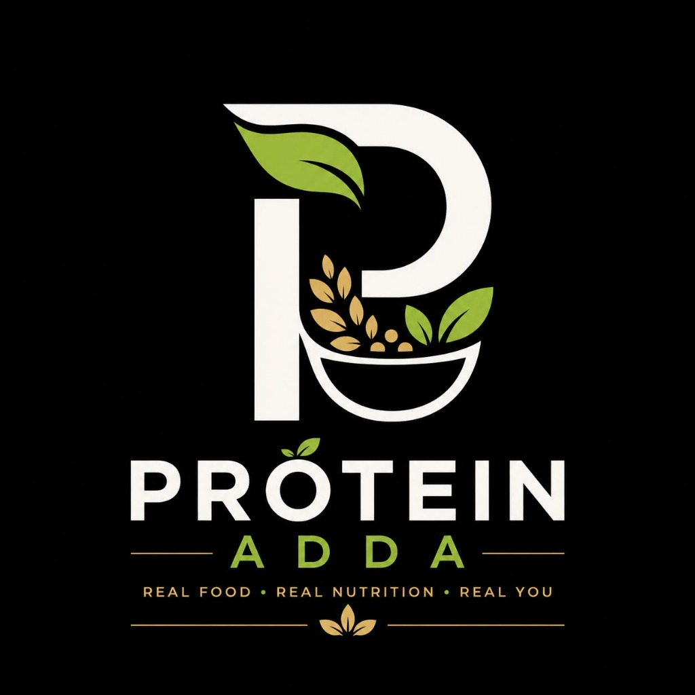

# PROTEIN ADDA — Real Food. Real Nutrition. Real You.

> A healthy-food startup digital brand experience founded by **Vishal** in Guwahati, Assam (Zoo Road, Opposite AIDC Complex Office).



---

## 🌟 About Protein Adda

Protein Adda was started by young entrepreneur **Vishal**, who began his journey from a roadside food stall on Zoo Road, Guwahati. His vision is to make healthy, nutritious, and protein-rich food accessible and affordable for everyday customers, gym-goers, and office commuters.

- **Operating Hours**: 7:00 AM – 11:00 AM Daily
- **Flagship Location**: Zoo Road (Opposite AIDC Complex Office), Guwahati, Assam - 781024
- **Instagram Daily Hustle Series**: [@proteinadda2026](https://www.instagram.com/proteinadda2026/)

---

## ⚡ Tech Stack

- **Framework**: [Next.js 16](https://nextjs.org/) (App Router & Turbopack)
- **Library**: [React 19](https://react.dev/)
- **Language**: [TypeScript](https://www.typescriptlang.org/)
- **Styling**: [Tailwind CSS v4](https://tailwindcss.com/)
- **Icons**: [Lucide React](https://lucide.dev/) + Custom SVG Brand Icons
- **Typography**: Google Fonts (Outfit & Inter)

---

## 🥗 Website Features

1. **Sticky Header & Top Ticker**: Live operating hours ticker and instant WhatsApp CTA button.
2. **Hero Section**: High-impact dark aesthetic, "GOOD FOOD. FUEL YOUR BETTER DAYS." headline with real food photography and floating ingredient badges.
3. **Brand Philosophy**: 3 core pillars (*Good Ingredients, Nutrition Focused, Made with Care*).
4. **Signature Menu with Interactive Ingredients**:
   - **High Protein Oats Bowl** (₹99) — *Customer Favourite*
   - **Classic Oats Bowl** (₹79) — *Everyday Favourite*
   - **Healthy Sandwich** (₹59) — *Healthy Bite*
   - **View Details & Ingredients**: Clickable button on every item to toggle the full itemized list of fresh ingredients.
   - **Order Now Button**: Automatically generates pre-filled WhatsApp order messages.
   - **Stall Poster Lightbox**: High-res view of the authentic stall poster.
5. **Why Protein Adda?**: Bento layout with real stall prep photography and 4 core lifestyle benefits.
6. **The Founder's Story**: Vishal's authentic journey from roadside stall to startup with bold quote: *"START SMALL. DREAM BIG. STAY CONSISTENT."*
7. **Documentary Timeline**: Day 1 to Day Infinity startup journey cards with video play overlays linking to Instagram.
8. **Visit Our Location**: Side-by-side location card + dark-themed interactive Google Map embed with direct directions.
9. **Instagram Community Showcase**: Behind-the-scenes moments and direct link to follow [@proteinadda2026](https://www.instagram.com/proteinadda2026/).
10. **Final High-Impact CTA**: Food glow background with fast ordering access.
11. **Mobile Floating WhatsApp Button**: Pulsating quick-order pill for mobile discovery.

---

## 🛠️ Central Configuration

All business numbers, addresses, menu items, prices, ingredients, and social links are centrally managed in:
```typescript
src/config/siteConfig.ts
```

---

## 🚀 Getting Started

### 1. Install dependencies
```bash
npm install
```

### 2. Run the development server
```bash
npm run dev
```
Open [http://localhost:3000](http://localhost:3000) in your browser.

### 3. Build for production
```bash
npm run build
npm run start
```

---

## 📄 License
© 2026 Protein Adda. All Rights Reserved.
